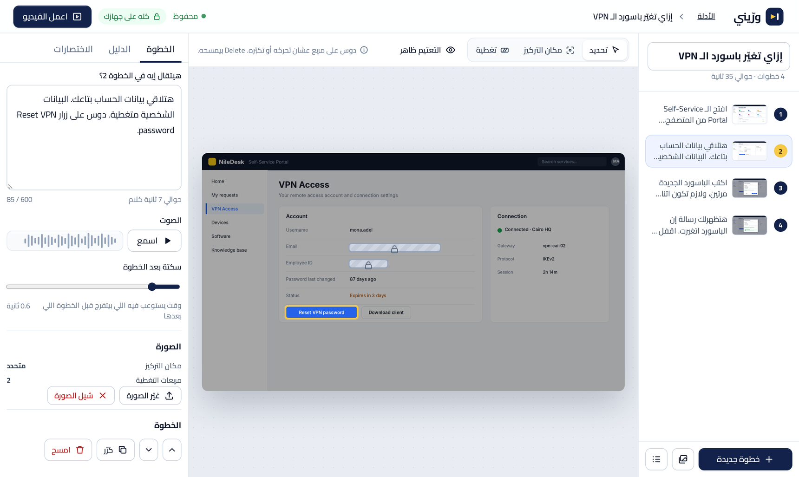

<div align="center" dir="rtl">

# ورّيني · Warrini

**حوّل خطوات الشغل المكتوبة لفيديو شرح قصير بصوت مصري.**
مجاني ومفتوح المصدر. بيشتغل على جهازك. من غير حساب، ومن غير API key، ومن غير ما حاجة تترفع على النت.

[English](README.md)



▶️ [شوف فيديو مثال (٣٧ ثانية)](docs/demo.mp4) اتعمل بورّيني من `examples/vpn-password` بالصوت المصري المحلي.

</div>

<div dir="rtl">

## المشكلة

أي فريق IT أو HR أو حسابات عنده ملفات SOP في Word فيها صور: «افتح الـ portal، دوس Reset password، اكتب الجديدة…». محدش بيقراها، وبيكلموا الـ Service Desk.

الفيديو القصير بيوصل أحسن بكتير، بس تسجيل وعمل مونتاج لكل إجراء بياخد ساعات، ومحتاج صوت هادي وخبرة مونتاج، وكل ما الشاشة تتغير تسجّل من الأول. والأدوات اللي بتعمل كده بفلوس، وبتشتغل على السحابة (يعني صور السيستم الداخلي بتطلع برّه الشركة)، ومفيش واحدة فيهم بتتكلم مصري.

## ورّيني بيعمل إيه

بتكتب الخطوات زي ما بتشرحها لزميلك، وتلزق لقطة شاشة لكل خطوة، وتدوس **اعمل الفيديو**. بيطلعلك فيديو 1080p فيه:

- **صوت مصري** (طارق، من موديل VoiceTut-TTS المفتوح) بيقرا كل خطوة، وشغال على جهازك.
- **كاميرا بتروح للمكان المهم.** ترسم مربع حوالين الزرار، والفيديو يقرّب عليه بنعومة، ويحط حواليه إطار، ويعتّم الباقي.
- **البيانات الحساسة متغطية.** ترسم مربع على إيميل أو رقم موظف، فيتغطى بلون مصمت في كل فريم. البكسلات الأصلية عمرها ما بتوصل للفيديو.
- **ترجمة عربي بتتقري صح**، حتى لو السطر بيبدأ بكلمة إنجليزي زي «VPN».
- كارت عنوان، ورقم كل خطوة («الخطوة ٢ من ٤»)، وشريط تقدّم، وكارت نهاية. ومعاه ملف `.srt`.

لو عدّلت خطوة واحدة وعملت الفيديو تاني، صوت باقي الخطوات بييجي من الكاش على طول.

## تبدأ إزاي

محتاج **Python 3.11 أو أحدث** و **ffmpeg فيه libass** (الأمر `warrini doctor` بيتأكدلك).

```bash
pip install "warrini @ git+https://github.com/morgankotb7-eng/warrini"
warrini
```

المتصفح هيفتح على البرنامج. الأدلة بتتحفظ في `~/Warrini` (فولدر لكل دليل).

### الصوت المصري المحلي

الصوت بيشتغل على جهازك، فمحتاج PyTorch وتنزيل الموديل مرة واحدة (حوالي 2 جيجا):

```bash
pip install "warrini[voicetut] @ git+https://github.com/morgankotb7-eng/warrini"
```

على CPU عادي مش سريع: تحميل الموديل بياخد دقيقتين تقريباً، وبعدها ممكن توصل لحوالي دقيقة لكل خطوة (على GPU أسرع بكتير). صوت كل خطوة بيتعمل مرة واحدة ويتحفظ، فلو عدّلت خطوة بتستنى عليها هي بس.

مش عايز تنزّل 2 جيجا؟ من تبويب **الدليل** فعّل **اسمح بالصوت الأونلاين**. ده بيستخدم صوت Microsoft المصري المجاني: أسرع، بس نص الخطوات بيتبعت لـ Microsoft. الصور والفيديو برضه مش بيطلعوا من جهازك. ورّيني عمره ما بيطلع أونلاين إلا لو الدليل سامح بكده.

### ffmpeg

| النظام | الأمر |
|---|---|
| Windows | <code dir="ltr">winget install Gyan.FFmpeg</code> |
| macOS | <code dir="ltr">brew tap homebrew-ffmpeg/ffmpeg && brew install homebrew-ffmpeg/ffmpeg/ffmpeg</code> |
| Ubuntu / Debian | <code dir="ltr">sudo apt install ffmpeg</code> |

## استخدام البرنامج

| | |
|---|---|
| **دليل جديد** | اكتب العنوان، ولو حابب الصق الخطوات من ملف الـ SOP: كل سطر مترقّم أو عليه شَرطة بيبقى خطوة. |
| **الصور** | <kbd>Ctrl+V</kbd> بيلزق لقطة الشاشة في الخطوة الحالية (أو خطوة جديدة). اسحب كذا صورة مرة واحدة يبقى كل صورة خطوة. |
| **مكان التركيز** (<kbd>F</kbd>) | ارسم مربع حوالين الحاجة اللي هيدوس عليها. الكاميرا هتقرّب هناك. |
| **تغطية** (<kbd>B</kbd>) | ارسم مربع على أي حاجة خاصة. لو غيّرت الصورة، البرنامج هيطلب منك تراجع التغطية قبل الفيديو اللي بعده. |
| **اسمع** | اسمع الخطوة قبل ما تعمل الفيديو. |
| **اعمل الفيديو** | <kbd>Ctrl+Enter</kbd>. اختار 1080p، أو معاينة سريعة 720p. |

التراجع والإعادة شغالين في كل حتة (<kbd>Ctrl+Z</kbd> / <kbd>Ctrl+Y</kbd>)، وكل حاجة بتتحفظ لوحدها.

## من الـ terminal

```bash
warrini render ~/Warrini/vpn-password
warrini render guide.json --quality fast -o out.mp4
warrini import-folder ./screenshots --title "تجهيز لابتوب جديد"
warrini doctor
```

## الخصوصية والأمان

- البرنامج بيسمع على `127.0.0.1` بس. المتصفح بياخد كود سري جديد في كل تشغيلة عن طريق cookie من نوع `HttpOnly` و `SameSite=Strict`، وأي تعديل محتاج كمان token في الـ header، وبيتأكد من الـ `Host`. يعني أي موقع تاني أو أي يوزر تاني على نفس الجهاز مش هيقدر يقرا أو يعدّل الأدلة بتاعتك.
- الملفات اللي بتترفع بيتأكد من نوعها الحقيقي وحجمها وعدد البكسلات، وبتتحفظ PNG من جديد (وده بيشيل بيانات الـ EXIF والـ GPS) بأسماء البرنامج هو اللي بيختارها.
- أماكن التغطية بتتملي قبل أي تكبير أو تصغير، فمفيش فريم ممكن يظهرها. بس **الصور الأصلية** بتفضل في فولدر `images/` بتاع الدليل، فخلّي بالك منه.

## الترخيص

MIT. خط Cairo اللي جوه البرنامج ترخيصه SIL Open Font License.

</div>
