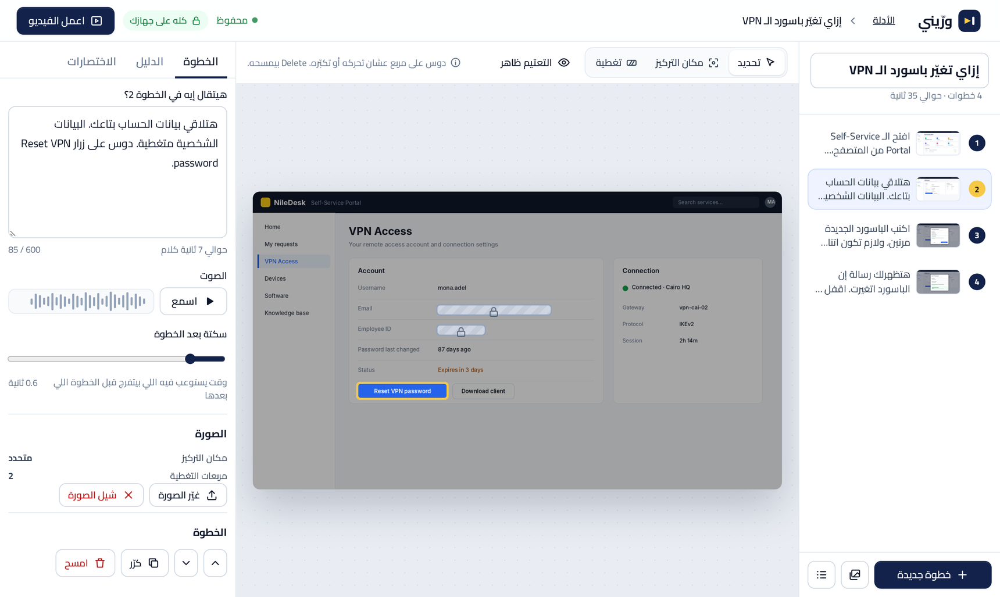
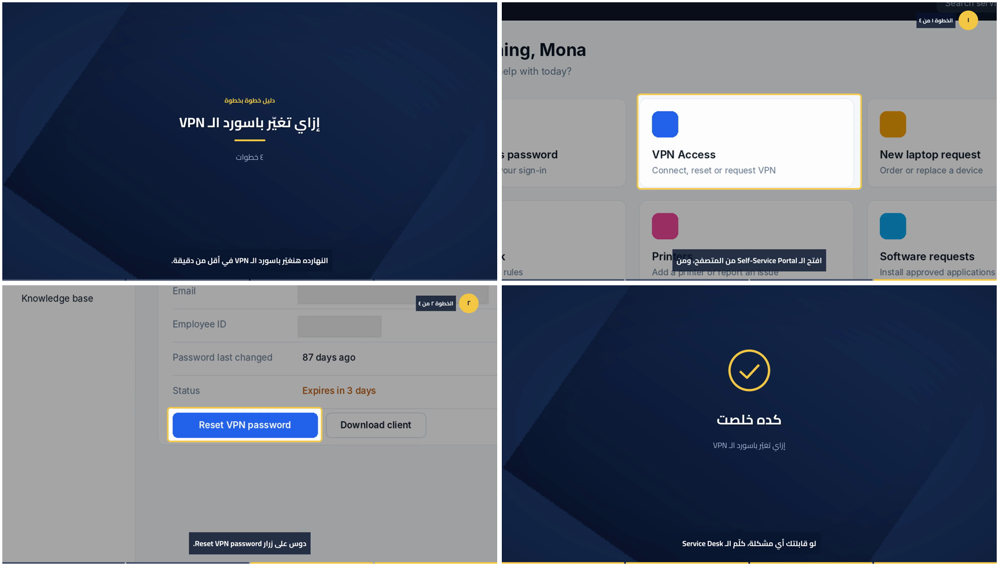

<div align="center">

# Warrini · ورّيني

**Turn a written work procedure into a short narrated how-to video, with an Egyptian Arabic voice.**
Free and open source. Runs on your machine. No account, no API key, nothing uploaded.

[](https://github.com/morgankotb7-eng/warrini/actions/workflows/ci.yml)


[](LICENSE)

[العربي](README.ar.md)




▶️ [Watch a 37-second example](docs/demo.mp4), made by Warrini from `examples/vpn-password` with the local Egyptian voice.

</div>

## The problem

Every IT, HR or finance team has SOPs in Word with screenshots: "open the portal, click Reset
password, type the new one…". People don't read them. They call the service desk instead.

A short video works much better, but recording and editing one per procedure takes hours, needs a
calm voice and editing skills, and every time the UI changes you record it again. The tools that
generate these videos are paid, run in the cloud (so your internal screenshots leave the company),
and none of them speaks Egyptian Arabic.

## What Warrini does

You write the steps the way you'd explain them to a colleague, paste a screenshot for each one,
and press **Make the video**. You get a 1080p MP4 with:

- **An Egyptian voice** (Tareq, from the open VoiceTut-TTS model) reading each step, running locally.
- **A camera that moves to what matters.** Draw a box around the button; the video zooms in
  smoothly, puts a ring around it and dims the rest.
- **Sensitive data covered.** Draw a box over an email or an employee ID and it is replaced with an
  opaque fill in every frame. The original pixels never reach the video.
- **Arabic captions that read right**, including lines that start with English words like "VPN".
- A title card, step badges ("الخطوة ٢ من ٤"), a progress bar and an end card. Plus an `.srt` file.

Edit one step and render again: the voice of every unchanged step comes from the cache.

<div align="center">

</div>

## Quick start

### Windows: one installer

Download **Warrini-Setup** from the [latest release](https://github.com/morgankotb7-eng/warrini/releases/latest),
double-click it, and open **ورّيني** from the Start menu or the desktop. Python, ffmpeg and the local
Egyptian voice are inside; nothing else to install, and no admin rights needed.

The installer is not code-signed yet, so Windows may show "Windows protected your PC". Click
**More info** → **Run anyway**. The first time you listen to a step or make a video, the voice model
downloads once (about 2 GB).

### Any OS, with Python

You need **Python 3.11+** and **ffmpeg with libass** (`warrini doctor` checks it for you).

```bash
pip install "warrini @ git+https://github.com/morgankotb7-eng/warrini"
warrini
```

Your browser opens on the editor. Guides are saved in `~/Warrini` (one folder per guide).

### The local Egyptian voice

The voice runs on your machine, so it needs PyTorch and a one-time model download (about 2 GB):

```bash
pip install "warrini[voicetut] @ git+https://github.com/morgankotb7-eng/warrini"
```

It is not fast on a plain CPU: loading the model takes a couple of minutes, then expect up to about
a minute per step (a GPU is much faster). Each step's voice is made once and cached, so editing one
step and rendering again only waits for that step.

Don't want the 2 GB? Open the guide's **Guide** tab and turn on **Allow the online voice**. That
uses Microsoft's free Egyptian voice: faster, but the step text is sent to Microsoft. Screenshots
and the video still never leave your machine. Warrini never goes online unless a guide says so.

### ffmpeg

| OS | Command |
|---|---|
| Windows | `winget install Gyan.FFmpeg` |
| macOS | `brew tap homebrew-ffmpeg/ffmpeg && brew install homebrew-ffmpeg/ffmpeg/ffmpeg` (the default `brew install ffmpeg` may lack libass) |
| Ubuntu / Debian | `sudo apt install ffmpeg` |

## Using the editor

| | |
|---|---|
| **New guide** | Give it a title, and optionally paste the steps from your SOP. Numbered or bulleted lines become steps. |
| **Screenshots** | `Ctrl+V` pastes a screenshot into the current step (or a new one). Drag several images in to make one step per image. |
| **Focus** (`F`) | Draw a box around the thing to click. The camera zooms there. |
| **Cover** (`B`) | Draw a box over anything private. Replacing a screenshot asks you to re-check its covers before the next render. |
| **Listen** | Hear a step before you render. |
| **Make the video** | `Ctrl+Enter`. Choose 1080p, or a quick 720p preview. |

Undo and redo work everywhere (`Ctrl+Z` / `Ctrl+Y`). Everything autosaves.

## Command line

```bash
warrini render ~/Warrini/vpn-password            # guide folder or guide.json
warrini render guide.json --quality fast -o out.mp4
warrini import-folder ./screenshots --title "New laptop setup"   # one step per image
warrini doctor
```

Exit codes: `0` done, `1` something in the guide needs fixing, `2` a tool is missing, `3` the render failed.

## Privacy and security

- The app listens on `127.0.0.1` only. The browser gets a per-run secret through an `HttpOnly`,
  `SameSite=Strict` cookie, every change also needs a token header, and the `Host` header is
  checked, so other websites and other users on the machine can't read or change your guides.
- Uploaded files are checked by content, size and pixel count, re-encoded to PNG (which also strips
  EXIF and GPS data) and stored under server-generated names.
- Covered areas are filled before any scaling, so no frame can show them. The **original**
  screenshots stay in the guide's `images/` folder; treat that folder as sensitive.

See [SECURITY.md](SECURITY.md) to report a problem.

## How it works

Warrini builds on [ehky](https://github.com/morgankotb7-eng/ehky) (voice and Arabic caption timing).
Frames are drawn with Pillow from a 2x canvas per step, so slow zooms move smoothly by fractions of
a pixel instead of jumping. All text goes through libass inside ffmpeg, which shapes Arabic
correctly on every OS. Audio is normalized to −16 LUFS. The full design, including the review that
shaped it, is in [docs/designs/design.md](docs/designs/design.md).

## Example

`examples/vpn-password` is a complete guide for a made-up portal. Render it with:

```bash
warrini render examples/vpn-password
```

## License

MIT. The bundled Cairo font is under the SIL Open Font License (see `warrini/assets/fonts/OFL.txt`).
